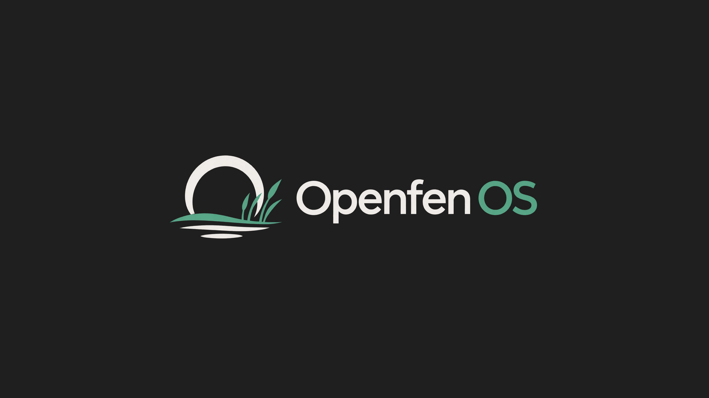

<p align="center">
  
</p>

<h1 align="center">Openfen OS</h1>

<p align="center"><strong>Privacy by nature. Security by design.</strong></p>
<p align="center"><strong>Pre-alpha development preview · Fedora 44 bootc · GNOME / Wayland</strong></p>

Openfen is an open-source, privacy-focused Linux operating system project built on Fedora's bootc technology. The name combines **open** (open source, transparency, and user control) with **fen** (a quiet wetland landscape). Openfen aims to offer a cohesive, approachable privacy desktop with carefully designed security defaults.

> [!WARNING]
> **This is an early development project, not a security-hardened release.** The current image is suitable for development and VM testing only. It does **not** yet enforce disk encryption, a VPN-only network path, anonymity, or the other planned privacy protections. Do not rely on it to protect sensitive identities, investigations, or data.

## Current status

The repository provides a **Fedora 44 bootc-derived GNOME development image** that has been built and booted successfully in a QEMU/KVM virtual machine.

### Implemented and tested in development

- GNOME desktop running on Wayland, with GDM.
- Openfen OS identity in `os-release`.
- Openfen login logo and two selectable branded wallpapers, with a charcoal/dark default.
- A bootc-based system image with a read-only operating-system foundation.
- Successful VM boot tests with SELinux enforcing and no failed systemd units at the time of testing.

### Planned, not yet delivered

- LUKS2-encrypted installed systems and installer/first-run experience.
- Fail-closed WireGuard/Mullvad networking with transparent connection and identity controls.
- Isolated investigative workspaces and optional OSINT/forensics tooling.
- Optional secure communications and Monero wallet integrations.
- Portable encrypted installations, amnesic live media, and optional encrypted persistence.
- A documented, independently verified release-signing and update process.

The Plymouth boot splash is under active development; its appearance and reliability are not yet considered verified.

**There are no supported downloadable releases or bare-metal installation instructions yet.** The instructions below build a local development image and run it in a VM.

## Repository layout

| Path | Purpose |
| --- | --- |
| `image/Containerfile` | Fedora bootc image recipe |
| `image/branding/os-release` | Openfen system identity |
| `image/branding/logos/` | Original PNG logo assets |
| `image/branding/wallpapers/` | Desktop wallpapers |
| `image/branding/*.gschema.override` | GNOME and GDM defaults |
| `image/branding/openfen-backgrounds.xml` | GNOME wallpaper catalogue |
| `vm/config.toml` | Local VM account configuration (**ignored by Git**) |
| `vm/*-output/` and `vm/output/` | Generated virtual disks (**ignored by Git**) |

## Developer quick start (Fedora host)

The following workflow targets **Fedora Workstation on x86_64**. Other Linux hosts may work but are not currently documented or tested.

### 1. Prerequisites

You will need a CPU with hardware virtualisation (Intel VT-x or AMD-V), internet access, sudo privileges, and enough disk space for container layers and virtual disks. **40 GB of free space** is a practical starting recommendation. A VM allocation of **4 vCPUs and 8 GB RAM** is recommended for desktop testing.

Install the tools on your **Fedora host**:

```bash
sudo dnf install -y \
  git podman openssl \
  virt-manager qemu-kvm qemu-img \
  libvirt-daemon-kvm libvirt-daemon-config-network \
  edk2-ovmf
```

Fedora uses modular libvirt services on current releases. If virt-manager cannot connect to QEMU/KVM, enable the relevant sockets:

```bash
sudo systemctl enable --now \
  virtqemud.socket virtnetworkd.socket virtstoraged.socket
```

In virt-manager, use the **QEMU/KVM system** connection.

### 2. Clone the repository

```bash
git clone https://github.com/openfen/openfen-os.git
cd openfen-os
```

### 3. Build the Openfen container image

```bash
sudo podman build \
  --network=host \
  --tag localhost/openfen-os:gnome-dev \
  --file image/Containerfile \
  image/
```

This builds the operating-system **container image**, not a bootable QCOW2 disk. The build performs a `bootc container lint` check. On an I/O-constrained workstation, optionally prefix `podman build` with `sudo ionice -c3 nice -n 10` instead of plain `sudo` to reduce I/O priority.

> These instructions use **rootful Podman**. The image builder must access the same container storage where the Openfen image was built.

### 4. Create a local VM account configuration

Generate a password hash, entering a **unique development-only password** when prompted:

```bash
openssl passwd -6
```

Create `vm/config.toml` using your editor:

```bash
mkdir -p vm
nano vm/config.toml
```

Paste the following TOML, replacing the placeholder with the full password hash:

```toml
[[customizations.user]]
name = "openfen"
password = "PASTE_YOUR_GENERATED_PASSWORD_HASH_HERE"
groups = ["wheel"]
```

Restrict access to the file:

```bash
chmod 600 vm/config.toml
```

**Never commit `vm/config.toml` or share real passwords or password hashes.** The file is ignored by Git. No default development password is distributed.

### 5. Convert the container image to QCOW2

The QCOW2 build uses `bootc-image-builder`. It is separate from `podman build` and **does** use the local `vm/config.toml` file.

```bash
mkdir -p vm/output

sudo podman run --rm --privileged \
  --security-opt label=type:unconfined_t \
  -v "$(pwd)/vm/output:/output" \
  -v "$(pwd)/vm/config.toml:/config.toml:ro" \
  -v /var/lib/containers/storage:/var/lib/containers/storage \
  quay.io/centos-bootc/bootc-image-builder:latest \
  --type qcow2 \
  --rootfs btrfs \
  --config /config.toml \
  localhost/openfen-os:gnome-dev
```

The resulting disk is expected at `vm/output/qcow2/disk.qcow2`.

```bash
ls -lh vm/output/qcow2/disk.qcow2
qemu-img info vm/output/qcow2/disk.qcow2
```

The image builder runs with elevated privileges. Only build images and inputs you trust.

### 6. Import the disk into virt-manager

1. Start **Virtual Machine Manager** (`virt-manager`).
2. Select **Create a new virtual machine → Import existing disk image**.
3. Select `vm/output/qcow2/disk.qcow2`.
4. Choose a suitable Fedora/Linux OS profile, **4 vCPUs**, and **8 GB RAM** (development recommendations).
5. Select **Customise configuration before install** and ensure **UEFI/OVMF** firmware is selected.
6. Start the VM and log in as `openfen` using the password configured in `vm/config.toml`.

If libvirt cannot access a disk under your home directory, copy it into the libvirt image directory and use that copy instead:

```bash
sudo cp vm/output/qcow2/disk.qcow2 /var/lib/libvirt/images/openfen-dev.qcow2
sudo restorecon -v /var/lib/libvirt/images/openfen-dev.qcow2
```

Use a **new VM** for each newly generated disk during development. Do not overwrite a disk while its VM is running.

### 7. Verify the running guest

Run these commands **inside the Openfen VM**, not on the Fedora host:

```bash
cat /etc/os-release
echo "$XDG_SESSION_TYPE"
getenforce
systemctl --failed --no-pager
sudo bootc status
```

Check that the OS identifies as Openfen, the session uses Wayland, SELinux is enforcing, and bootc reports a deployment. Visit **Settings → Appearance** to view the Openfen wallpapers. These checks are **not** a security certification.

A newly built VM's hostname may be `localhost` or another default until it is explicitly configured. For a development VM only:

```bash
sudo hostnamectl set-hostname openfen-dev
```

### 8. Common development notes

- `podman build` stores its result in **local Podman storage**. `git push` does not publish Podman images.
- `bootc-image-builder` produces a **local QCOW2 disk**, not a GitHub release or a physical-device installer.
- Generated VM disks, VM output directories, and `vm/config.toml` are excluded from version control.
- Fedora remains Openfen's technical upstream. Visual branding alone does not provide privacy or anonymity.
- The boot splash is experimental; graphics and console rendering need additional validation.

## Upstream references

- [Fedora bootc](https://docs.fedoraproject.org/en-US/bootc/)
- [bootc image builder](https://github.com/osbuild/bootc-image-builder)
- [Image Builder configuration reference](https://osbuild.org/docs/user-guide/blueprint-reference/)
- [virt-manager](https://virt-manager.org/)

## Project

Source and issue tracking: [github.com/openfen/openfen-os](https://github.com/openfen/openfen-os).

Openfen's branding, architecture, and release processes will continue to evolve during development.

## Licence

Original Openfen source code is licensed under the
[GNU GPL v3 or later](LICENSE).

See [LICENSING.md](LICENSING.md) for the scope of this
licence, third-party dependencies, and branding rights.
